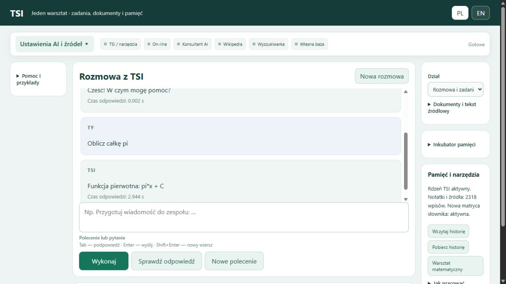
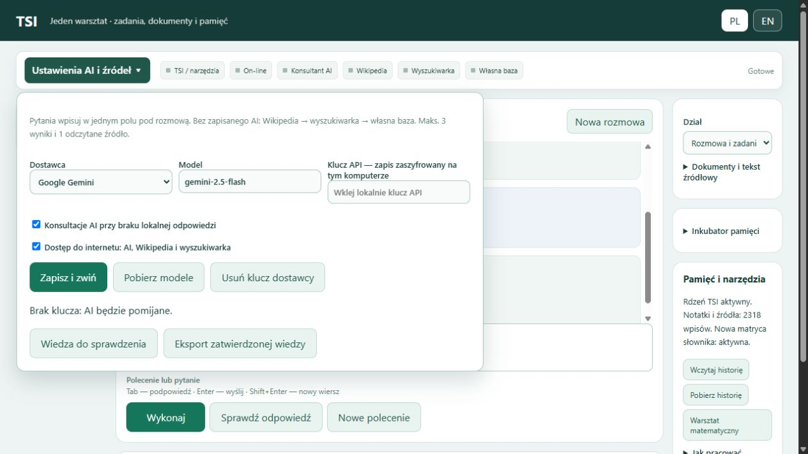
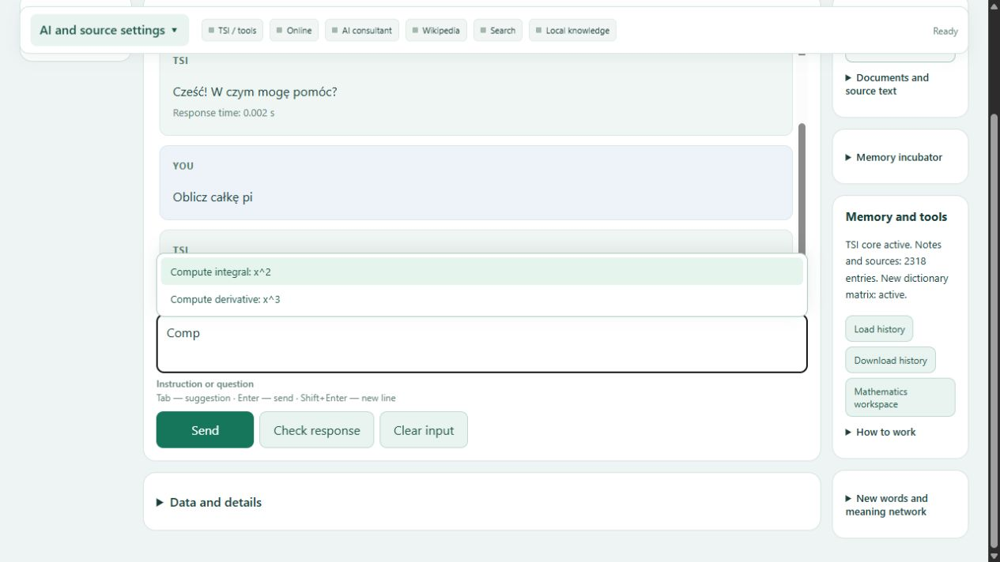

# AI-SI-TSI — własny model TSI

**Stan: 29 października 2026.** Lokalny model **plan-decoder-8m-3** ma **8 081 032 parametry**. Repozytorium udostępnia dokumentację; bieżący kod, wagi, słowniki i prywatna pamięć pozostają lokalnie.

## Co działa obecnie

- **Nowe API rdzenia — obsługa zadań**: całki, pochodne, równania i macierze przez lokalny solver; projekt budżetu przez narzędzie MUZ. Jeden moduł koordynuje zadanie, wynik jest sprawdzany, a dekoder TSI składa odpowiedź według planu. Tryb `auto` nie przechodzi już do kopiowania słowa dla nieznanego polecenia.
- **Odczyt prostych zdań** ze słownika i reguł: podmiot, czynność, dopełnienie, przypadki i zaprzeczenie. Zmieniona kolejność słów nie wyznacza automatycznie ich ról.
- **Odmiana i uzgadnianie form**: osoba, liczba, rodzaj, przypadek, przymiotniki, liczebniki 0–10 i zbiorowe, czas teraźniejszy, przeszły i przyszły oraz tryb przypuszczający. Obsługiwane są wybrane konstrukcje z „się”.
- **Kontekst kilku prostych zdań** i odniesienia podmiotowych zaimków „on/ona”. Niejednoznaczność powoduje doprecyzowanie. Konteksty zapytań są oddzielone.
- **Pytania o treść**: kto, co, kogo, komu, czego, kim, czym. Odpowiedź uwzględnia czas i zaprzeczenie oraz wskazuje zdania źródłowe.
- **Polecenia na kontekście**: wypisywanie potwierdzonych osób i czynności, porównanie dwóch zdań oraz wskazanie sprzecznych faktów. Osoby są rozpoznawane z cech słownikowych i lokalnej bazy znaczeń; nierozstrzygnięta klasyfikacja wymaga doprecyzowania.
- **Chroniona logika dwu- i trójstanowa** oraz wykonanie dynamicznego planu przez dekoder sieciowy, również dla dłuższych odpowiedzi i znaków UTF-8.
- **Nauczyciel AI i źródła** w istniejącym panelu: wybór Gemini, OpenAI, Claude lub pracy bez AI; przy braku klucza konsultacja jest pomijana. Następnie Wikipedia, wyszukiwarka i podpowiedź z własnej bazy.
- **Jedna rozmowa i jedno pole pytań**, rozwijane ustawienia AI oraz wskaźniki etapów pracy narzędzi.
- **Rozmowy wieloetapowe w panelu**: korekta godziny, powrót do wcześniejszego tekstu, doprecyzowanie zadania i reset kontekstu. Pytania o osoby działają w PL/EN; imię pozostaje imieniem także po zmianie języka interfejsu.
- **Wspólna kontrola trafności źródeł**: odmiana, synonimy, temat i wymagany rodzaj odpowiedzi. Brak daty, miejsca lub liczby powoduje doprecyzowanie. Przykład ze słownika nie zastępuje informacji o konkretnej rozmowie.
- **Kalendarz świąt w istniejącym panelu**: przywrócone połączenie z modułem dat, lista polskich świąt oraz wybrane pytania o daty; obsługa PL/EN.
- **Reguły grzecznościowe PL/EN**: powitania, podziękowania, pożegnania oraz spokojna reakcja na obrażanie. Cytat albo zadanie zawierające przekleństwo nie jest automatycznie blokowane.

Odczyt ról i wybór faktów korzystają z chronionych reguł oraz słowników. Treść przygotowanego planu emituje dekoder sieciowy; jego błędny wynik nie jest zastępowany poprawnym gotowcem. Powitania i pozostałe akty grzecznościowe mają osobną, jawną ścieżkę regułową, zgodnie z ich przeznaczeniem.

**Swobodna rozmowa nie osiągnęła wymaganego poziomu.** Nowe odczyty, pytania i polecenia działają w lokalnym API i CLI. Panel na porcie 8791 otrzymał reguły grzecznościowe i naprawione kierowanie pytań o święta; jego dotychczasowy rdzeń pozostaje bez podmiany. MUZ, walidator i istniejące portable wymagają osobnej aktualizacji. Naprawiono wybór trybu w nowym API: polecenia matematyczne trafiają do planera i solvera, a brak danych powoduje pytanie o uzupełnienie. Pełna wymiana modelu w aplikacjach pozostaje osobnym etapem. Obie aplikacje korzystają już ze wspólnej instalacji dotychczasowej obsługi TSI.

## Przykłady rzeczywistych wyników

| Dane lub tekst | Zadanie | Wynik |
|---|---|---|
| Książkę czyta Ola. | Odczytaj i ułóż zdanie | **Ola czyta książkę.** |
| Uczeń czyta książkę. On śpi. | Powiąż odniesienie | **Uczeń czyta książkę. On śpi.** |
| Ola czyta książkę. | Kto czyta książkę? | **Ola.** |
| Ewa pomaga dziecku. | Komu pomaga Ewa? | **dziecku.** |
| Ola interesuje się książką. | Czym interesuje się Ola? | **książką.** |
| Ola nie czyta książki. | Czego nie czyta Ola? | **książki.** |
| Ola śpi. Ona czyta książkę. | Wypisz czynności | **Ola śpi. / Ola czyta książkę.** |
| Ola czyta książkę. Ola nie czyta książki. | Wskaż sprzeczności | **Zdania 1 i 2**, wraz z ich treścią |

`Porównaj zdania 1 i 2` pozwala wskazać parę w dłuższym kontekście. Porównanie rozróżnia podmiot, czynność, dopełnienie, czas i zaprzeczenie. Nieobsługiwanych dodatkowych warunków nie pomija się.

## Sprawdzenie obecnej wersji

| Kontrola | Wynik |
|---|---:|
| Odczyt prostych zdań / kontrole niejednoznaczności i braków | **22/22 / 10/10** |
| Automatyczny kontekst kilku zdań / kontrole | **6/6 / 4/4** |
| Pytania o kontekst / kontrole | **18/18 / 13/13** |
| Polecenia na kontekście / kontrole | **9/9 / 7/7** |
| Reguły grzecznościowe w działającym panelu PL/EN | **8/8** |
| Kalendarz świąt w działającym panelu PL/EN | **4/4** |
| Sprawdzone obliczenia panelu: dodawanie, odejmowanie, 2/7 | **4/4** |
| Grupy wyrazów / czasy i tryb | **20/20 / 18/18** |
| Wykonanie nowych planów odpowiedzi / braki i sprzeczne zalecenia | **24/24 / 4/4** |
| Wpisy słownika / próby brzegowe | **32/32 / 20/20** |
| Chroniona logika: dawne polecenia / pełne tablice | **15/15 / 57/57** |
| Testy techniczne nowego modułu | **117/117** |
| Nauczyciel AI, wyszukiwanie i wspólna kontrola źródeł | **43/43** |
| Integracja nauczyciela i zachowanie funkcji panelu | **9/9** |
| Rozmowy wieloetapowe panelu — 12 rozmów, liczba wypowiedzi | **40/40** |
| Dodatkowe warianty — 8 rozmów, liczba wypowiedzi | **18/18** |
| Utrzymanie brakujących danych zadania — testy techniczne | **11/11** |
| Korekty, powroty do tematu i rozdzielenie imion od odpowiedzi tak/nie | **9/9** |
| Nowe API rdzenia: zadania, doprecyzowania, PL/EN, logika i budżet syntetyczny | **14/14** |
| Zdania z opisem cechy i kontrola przeczenia / niezgodności | **5/5** |
| Ostatnia karta, odświeżenie, druga karta i blokada drugiego serwera | **4/4** |

Wyniki dotyczą wymienionych zakresów. Ostatnie rozszerzenia dodają reguły, połączenia i pełne paradygmaty dwóch haseł; wagi sieci pozostały na zatwierdzonym kroku **2850**.

Kalendarz opiera się na [oficjalnym tekście ustawy o dniach wolnych od pracy](https://api.sejm.gov.pl/eli/acts/DU/2025/296/text.pdf), sprawdzonym 28 października 2026. Matematyka panelu kieruje obliczenia do solvera, z niezależną kontrolą numeryczną. Ułamek 2/7 jest zachowany wraz z przybliżeniem dziesiętnym.

## Jedna obsługa polecenia w nowym API

`load_runtime().answer("Oblicz całkę pi")` zwraca **Funkcja pierwotna: pi*x + C**. Prośba o plan oszczędzania bez danych powoduje pytanie o historię wpływów i wydatków, saldo, datę oraz założenia. Po podaniu danych syntetycznych sprawdzono wykonanie projektu budżetu z zachowaniem całkowitych groszy, dat i oznaczenia projektu do oceny użytkownika.

API przyjmuje też zadanie już odczytane przez aplikację: `task="application"` oraz JSON z `operation` i `params`. Ten tryb omija ponowne parsowanie polecenia. Ślad `task_trace` rozdziela koordynację, planowanie, wykonanie solvera i sprawdzenie wyniku. Przy jednej operacji matematycznej sprawdzono **jedno wykonanie i jedno sprawdzenie**. Błąd dekodera albo weryfikacji pozostaje błędem; nie jest zastępowany poprawną odpowiedzią z gotowego wzorca.

To rozszerzenie sterowania zadaniami oraz korzystania z narzędzi. Checkpoint sieci pozostaje na kroku **2850**, bez zmiany wag. Wymiana modelu w MUZ i walidatorze nie została w tym etapie wykonana.

## Słowniki i wielkość

Własna baza odmiany SQLite zawiera **43 847 unikalnych kluczy lematów** i **1 874 187 rekordów form z cechami**. Zachowuje identyfikatory leksemów, homonimię i źródła. Odczyt działa bez importu Morfeusza. Dane SGJP pochodzą z częściowego lokalnego eksportu; zachowano [autorów i licencję BSD-2-Clause](https://morfeusz.sgjp.pl/doc/license/en). To nie jest pełny SGJP.

Klasyfikacja znaczeń korzysta również z istniejącej lokalnej sieci słownikowej, z zachowaniem odnośników do źródeł i znaczeń. Rozbieżne lub brakujące znaczenia nie stają się automatycznie pewną informacją.

| Składnik | Wielkość |
|---|---:|
| Sieć tekstowa: enkoder, dekoder, TIMDR i kanały planu | **8 081 032 parametry** |
| Chroniony moduł operatorów logicznych | **483 parametry** |
| Wagi sieci tekstowej FP32 | **30,83 MiB** |
| Checkpoint z optymalizatorem i stanem losowania | **92,71 MiB** |
| Aktywna własna baza odmiany | **353,25 MiB** |
| Katalog nowego modułu wraz z przebiegami i kopiami | **około 2,66 GiB** |
| Istniejąca instalacja aplikacji z danymi i historią | **około 3,59 GiB** |

Pomiary katalogów wykonano 28 października 2026; obejmują dane robocze i kopie, a instalacja miała dwa pliki niedostępne do odczytu. Nie są to rozmiary paczki portable.

1 MiB = 1 048 576 bajtów. Python, PyTorch, kod, pozostałe słowniki, dane i kopie bezpieczeństwa są dodatkowymi składnikami instalacji; tabela nie podaje wielkości kompletnego portable.

## Nauczyciel AI — konfiguracja

W panelu rozwiń **Ustawienia AI i źródeł**, wybierz dostawcę, wpisz lokalnie klucz, wybierz model i kliknij **Zapisz i zwiń**. Dostępne są Google Gemini, OpenAI, Anthropic Claude i **Bez AI**. Przycisk **Pobierz modele** działa po zapisaniu klucza. Klucz zapisany przez panel jest szyfrowany mechanizmem Windows DPAPI; można go usunąć osobnym przyciskiem. Nie wpisuj kluczy do rozmowy ani repozytorium.

Pytania wpisuje się w głównym polu pod rozmową. Narzędzia lokalne mają pierwszeństwo. Bez skonfigurowanego AI aplikacja pomija konsultację i próbuje Wikipedii oraz wyszukiwarki. Dla identyfikatorów projektów może przeszukać publiczne repozytoria GitHub i odczytać README; dla pozostałych zapytań korzysta z krótkich odpowiedzi i wyników RSS. Pobierane są najwyżej trzy kandydatury i treść jednej strony źródłowej, bez stronicowania. Nietrafny wynik jest odrzucany. Kontrola wykorzystuje lokalny słownik i strukturę pytania; nie jest automatycznym potwierdzeniem prawdziwości źródła. Błąd połączenia prowadzi do lokalnej podpowiedzi; wyłączenie internetu w ustawieniach wyłącza również konsultacje AI.

Przykładowy ciąg rozmowy: „Przeczytaj: Spotkanie odbędzie się o 09:30.” → „Nie, spotkanie będzie o 11:15.” → „Kiedy odbędzie się spotkanie?”. Odpowiedź wskazuje **11:15**. „Wróć do tekstu o kocie” przywraca pasujący wcześniejszy materiał; przy kilku pasujących tekstach aplikacja dopytuje. „Skąd wiesz o GIA-TIMDR?” wskazuje zapisane źródło. „Nowy temat” usuwa bieżący kontekst i oczekujące odwołania, zachowując trwałe notatki.

Odpowiedzi zewnętrzne trafiają do **Wiedzy do sprawdzenia**. Zatwierdzenie wymaga notatki, jak sprawdzono treść. Eksport JSONL obejmuje tylko zatwierdzone odpowiedzi. Nie zmienia on automatycznie wag TSI. Domyślny lokalny limit to 20 prób konsultacji dziennie; opłaty i limity zależą od dostawcy API. Prywatny materiał załączony do rozmowy nie jest automatycznie przekazywany nauczycielowi.

Panel utrzymuje oczekujące zadanie: po „Oblicz całkę” wiadomość „X^2” uzupełnia wzór i daje `x**3/3 + C`; po prośbie o granice można podać „od 0 do 2”. Wzór nie jest wtedy wyszukiwany jako hasło encyklopedii. Polecenie „Anuluj zadanie” usuwa oczekujące dane. Jawne obliczenie ma pierwszeństwo również przy włączonej pracy z dokumentem.

Podczas pisania pojawiają się **lokalne podpowiedzi PL/EN** z przykładów i krótkich poleceń widocznych w bieżącej rozmowie. **Tab** lub kliknięcie wstawia propozycję, strzałki zmieniają wybór, **Escape** chowa listę, a **Enter** wysyła pytanie. Podpowiedzi nie inicjują konsultacji AI.

Zamknięcie ostatniej karty panelu uruchamia wyłączenie serwera po **10 sekundach**; otwarcie lub odświeżenie panelu w tym czasie anuluje wyłączenie. Serwer ma wyłączne zajęcie portu Windows. Kontrola uruchomienia korzysta z lekkiego endpointu stanu, bez ładowania pełnych danych modelu.

Migający kwadracik oznacza bieżący etap pracy zgłoszony przez serwer. Stały kolor pokazuje narzędzia użyte przy ostatnim zapytaniu. Pasek pozostaje u góry podczas przewijania. „On-line” opisuje dostępność połączenia sieciowego; nie gwarantuje działania każdej witryny. Można korzystać z panelu offline.

## Uruchomienie i dalsza praca

Istniejący panel uruchamia **URUCHOM_TSI.bat** w głównym katalogu lokalnej instalacji. Adres: `http://127.0.0.1:8791/`. BAT został odtworzony. Dla nowych funkcji lokalnego modułu dostępne są m.in. zadania CLI `compose_text`, `compose_context`, `ask_context`, `context_command` i `courtesy`.

Następny krok: rozmowa z utrzymaniem tematu, krótkie pytania uzupełniające i doprecyzowanie odniesień. Podłączono również nauczyciela AI: odpowiedź ze źródłem → weryfikacja → zatwierdzona wiedza → trening. Obsługa dostawców jest podłączona do panelu; rzeczywista konsultacja wymaga lokalnego zapisania klucza API i wyboru modelu. Nie wykonano jeszcze rzeczywistego zapytania do płatnego API. Zachowywana jest jedna linia wag, optymalizatora i losowania. [Szczegóły aktualnego stanu](docs/STAN_TSI_2026-10-29.md).

## Aktualny panel

Zrzuty z 29 października 2026: jedna rozmowa, wspólne pole pytań, poziome ustawienia i wskaźniki użycia narzędzi.

## Historia i archiwum

[Historia prac](HISTORIA_TSI.md) · [README sprzed ostatniego rozszerzenia](docs/archiwum/README_przed_poleceniami_2026-10-28.md) · [Uczestnicy](CONTRIBUTORS.md)

[Historyczne paczki starego AI-SI — 8 zestawów ZIP, około 8,3 GB](https://github.com/jbackk-lang/AI-SI-TSI/releases/tag/archive-ai-si-2026-10-18) · [Spis i odtworzenie](docs/PACZKI_STAREGO_AI_SI.md)

[Walidator](https://github.com/jbackk-lang/TSI-math-validator-5) · [MUZ](https://github.com/jbackk-lang/TSI-MUZ)
