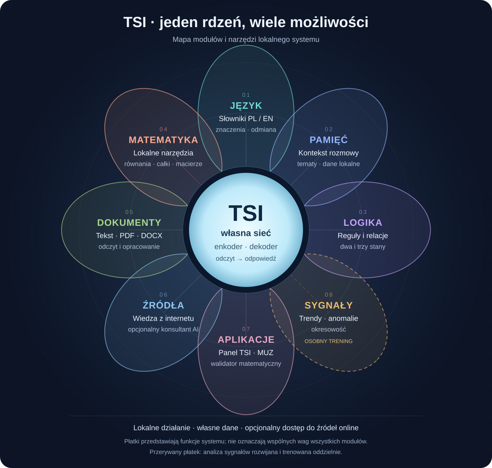
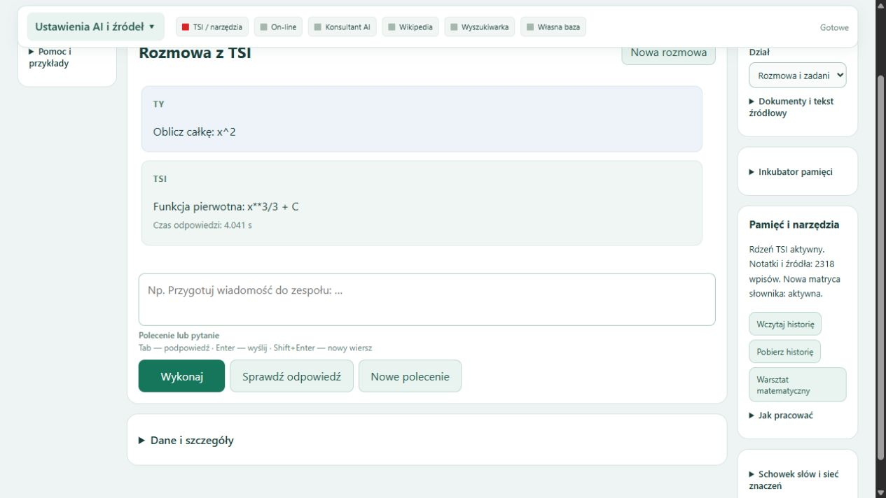

# AI-SI-TSI — lokalny system TSI

## Aktualny stan — etap 063

TSI i Math Walidator korzystają lokalnie ze wspólnego modułu analizy matematycznej. TSI zachowuje dziedzinę oryginalnego wzoru, analizuje całki, ekstrema, szeregi i rozwinięcia Taylora oraz dopasowuje wyjaśnienie do poziomu ucznia.

Etap 062 porównuje obserwowany rząd zbieżności trapezów i Simpsona po podwojeniu liczby podprzedziałów. Dla całki z x⁴ na [0,1] przejście z 4 do 8 podprzedziałów zmniejszyło błąd Simpsona 16 razy, co daje obserwowany rząd 4. Gdy jeden z błędów wynosi zero, rząd z ich ilorazu jest nieokreślony. Przeszło 6/6 wspólnych prób.

Etap 063 dodaje ekstrapolację Richardsona dla trapezów i Simpsona. Dla całki z x⁴ na [0,1] połączenie przybliżeń Simpsona z 4 i 8 podprzedziałów daje dokładnie 1/5. Przeszło 6/6 wspólnych prób.

Repozytorium publikuje dokumentację. Aktualny kod, wagi, pamięć, dokumenty i dane użytkownika pozostają lokalnie. Dawne AI-SI i modele zewnętrzne są opisane w [archiwach Releases](docs/PACZKI_STAREGO_AI_SI.md).

## Rdzeń i moduły TSI



To mapa funkcji systemu. Analiza sygnałów ma osobny trening.

## Architektura rdzenia i kierunek rozwoju

**Nadrzędny plan konstrukcyjny:** [TSI — architektura rdzenia i skomasowany plan rozwoju](docs/TSI_CORE_ROADMAP_AND_ARCHITECTURE.md).

To jedno miejsce określające docelowy podział rdzenia, potwierdzony stan, kolejność budowy, kryteria bezpieczeństwa i walidacji. Raporty wcześniejszych etapów pozostają materiałem źródłowym i historią, a nie osobnymi roadmapami.

Badania helisy i Chronoprocesu są częścią tego planu, ale pozostają eksperymentalne. Nie są wdrożoną funkcją TSI ani dowodem samonaprawy. Szczegóły badań: [notatka z 8 listopada](docs/HELIX_CHRONOPROCESS_TSI_RESEARCH_20261108.md).

## Możliwości do rozwinięcia i sprawdzenia

Kierunki z projektu [TSI Predikt Motor](https://github.com/jbackk-lang/TSI-Predikt-Motor).

- **Analizator na mikrokontrolerze.** Profil badawczy FordA ma 97 wartości, czyli 388 bajtów w zapisie `float32`. To same parametry profilu. Na prototypie z STM32H743 trzeba przenieść obliczanie cech do firmware’u i zmierzyć pamięć zajętą przez bufory i analizę widma, czas przetwarzania oraz zgodność wyników z wersją Python. [STM32H743](https://www.st.com/en/microcontrollers-microprocessors/stm32h743-753.html)
- **Predikt Motor jako samodzielne urządzenie.** Kandydatem do prototypu z dashboardem, raportami i zapisem pomiarów jest Raspberry Pi Compute Module 5 z 2 GB RAM i 16 GB eMMC. Do przygotowania jest wydanie Linux ARM64. Trzeba sprawdzić działanie z interfejsem OBD‑II i mikrofonem oraz zmierzyć zużycie pamięci i czas analizy. [Compute Module 5](https://www.raspberrypi.com/documentation/computers/compute-module.html)
- **Seria sygnałowa TSI.** Motor, Solar PV i Grid Monitor mogą używać wspólnego formatu profilu i kodu do liczenia cech. Każdy moduł potrzebuje własnych wejść, danych treningowych i progów. W każdym teście trzeba mierzyć wykryte zdarzenia i fałszywe alarmy na danych odłożonych od treningu.

Na oficjalnym teście FordA profil wykrył **618 z 639** przebiegów z oznaczonym objawem i zgłosił **29 alarmów w 681** przebiegach bez niego. Zbiór nie identyfikuje w raporcie konkretnej usterki. Wynik służy do porównań metod analizy sygnału. [Opis zbioru FordA](https://www.timeseriesclassification.com/description.php?Dataset=FordA)

## Co działa

- Odczyt podanego tekstu i dokumentów, pytania o dane, wskazywanie braków i sprzeczności oraz wybrane odwołania, role i przyczyny w rozmowie.
- Polska gramatyka GF składa i przekształca obsługiwane zdania, uzgadnia odmianę i rozróżnia czas zdarzenia od punktu odniesienia. Obsługuje dwie części zdania połączone przez „i”, „lub”, „ale”, „bo” lub „więc”. Wskazuje część, w której „teraz” koliduje z czasem przeszłym.
- Pamięć miejsc i podróży rozdziela zdarzenia osób wymienionych w opisie. TSI odpowiada, gdzie dana osoba jest teraz i gdzie była wcześniej. Korekta bez imienia dotyczy ostatniej zapisanej podróży. Przy niejednoznacznym zaimku TSI prosi o imię. Obsługa dotyczy wskazanych polskich konstrukcji.
- Dokumenty TXT, MD, CSV, DOCX i PDF. Stary DOC wymaga Microsoft Worda.
- Słowniki, odmiana wyrazów, notatki i lokalna pamięć. Nowe odpowiedzi ze źródeł są zapisywane do weryfikacji. Zatwierdzoną wiedzę można odnaleźć również przy zmianie sformułowania i odmiany słowa, przy pełnej zgodności rozpoznanych pojęć i warunków.
- Dokładne przeliczanie jednostek: długość, pole, objętość, masa, czas, prędkość, temperatura, ciśnienie i energia. Zachowanie ułamków, sprawdzanie wymiarów i rozróżnianie wielkości liter symboli SI.
- Audyt kolejnych równań: pierwszy błędny krok, utracone i dopisane rozwiązania, kontrprzykład oraz dziedzina. Dla jednej zmiennej x, 2–10 kroków; dokładne zbiory rozwiązań równań wymiernych do stopnia 6. Poza rozstrzygniętym zakresem możliwy wynik nierozstrzygnięty.
- Zadania łączone o **ruchu jednostajnym**: odczyt wielkości → przeliczenie jednostek → równanie → obliczenie → audyt → wyjaśnienie. Wyznaczanie drogi, prędkości lub czasu, korekta danej i kontrola rozwiązania ucznia w kontekście zadania.
- Zbieranie kątów trójkąta w kolejnych wiadomościach, korekty, wyjaśnienie i jawny powrót do zapisanego zadania. Arytmetyka czasu uwzględnia przejście przez północ.
- Lokalny panel PL/EN, ustawienia AI i źródeł, pasek aktywności. Wspólna obsługa w [walidatorze](https://github.com/jbackk-lang/TSI-math-validator-5) i [MUZ](https://github.com/jbackk-lang/TSI-MUZ), z osobną pamięcią aplikacji.

**Swobodna rozmowa nie osiągnęła wymaganego poziomu.** Poniższe wyniki dotyczą aplikacji z narzędziami i wskazanych zestawów.

## Aktualne sprawdzenia

| Zakres | Wynik |
|---|---:|
| Zmiany liczb, kolejności, jednostek, sformułowań i PL/EN w zadaniach z kątami i czasem | **568/568 wariantów** |
| Przeliczenia jednostek | **36/36**, dodatkowo **7/7** w panelu |
| Audyt równań | **20/20**, dodatkowo **8/8** w panelu |
| Zadania łączone o ruchu jednostajnym | **19/19**, dodatkowo **13/13** kroków rozmowy w panelu |
| Podłączenie walidatora | **15/15**, dodatkowo **7/7 HTTP** |
| Podłączenie MUZ | **15/15**, dodatkowo **7/7 HTTP** |
| Zdania GF z „ale”, „bo” i „więc”, kierunek przyczyny i konflikt czasu | **5/5** przez usługę rozmowy walidatora |
| Dopytania o miejsca jednej osoby | **6/6** kroków przez usługę rozmowy walidatora |
| Zdarzenia dwóch osób, korekta podróży i rozpoznanie brakującej informacji | **7/7** kroków przez usługę rozmowy walidatora |
| Dotychczasowe testy kontekstu, korekt i odzyskiwania odpowiedzi | **35/35** |

Zestawy częściowo sprawdzają te same mechanizmy — wyników nie sumujemy w jeden ogólny wskaźnik. [Przebieg, wykryte błędy i naprawy](HISTORIA_TSI.md#3-listopada-2026--rozmowa-narzędzia-i-podłączenie-aplikacji).

## Model i wielkość

| Składnik | Aktualny stan |
|---|---|
| Wdrożony moduł odpowiedzi | **krok 5217; 9 074 672 parametrów** |
| Jego parametry w FP32 | **34,62 MiB** |
| Większa sieć treningowa | **21 731 408 parametrów; ostatni zapis 5664**, niewdrożona do aplikacji |
| Parametry większej sieci w FP32 | **82,90 MiB** |

Rozmiary dotyczą samych parametrów. Pełna instalacja zawiera dodatkowo kod, Python, biblioteki, słowniki, pamięć i narzędzia; kopie i treningi nie są częścią rozmiaru samego modelu. Aktualizacja obsługi z 3 listopada nie zmienia wag.

Stałe reguły logiki dwu- i trójstanowej pozostają kontrolowanym elementem. Zwykłe „tak”, „nie” i „nie wiem” nie są automatycznie etykietami T/F/U.

## Jak korzystać

W instalacji lokalnej uruchom **URUCHOM_TSI.bat**; panel: `http://127.0.0.1:8791/`.

```text
Przelicz 72 km/h na m/s.
Rowerzysta jedzie 18 km/h przez 40 minut. Jaką drogę pokona?
Zmień czas na 25 minut.
```

Wyniki: **20 m/s**, **12 km**, po zmianie **15/2 km = 7,5 km**.

```text
Sprawdź moje rozwiązanie:
x=18*25
x=450
```

W kontekście poprzedniego zadania wskazany zostaje pierwszy wiersz: pominięto zmianę minut na godziny. Samodzielny audyt równań rozpoczyna się poleceniem **„Audyt równań:”**; każdy krok wpisz w osobnym wierszu. Założenie można podać w nagłówku, np. **„Audyt równań dla x≠0:”**.

Przykład rozmowy o miejscach:

```text
Ty: Ola była w domu, a Jan w ogrodzie. Potem Ola poszła do szkoły.
TSI: Zapisane.
Ty: Gdzie jest teraz Ola?
TSI: W szkole.
Ty: Pomyłka, poszła do biblioteki. A gdzie była wcześniej?
TSI: W domu.
Ty: Gdzie jest teraz Ola?
TSI: W bibliotece.
```

W **Ustawienia AI i źródeł** wybierz dostawcę albo **Bez AI**. Klucz zapisuj lokalnie. Bez klucza TSI pomija konsultację; bez internetu korzysta z dostępnych narzędzi i materiału lokalnego. Repozytorium dokumentacyjne nie instaluje aplikacji. Pełne lokalne portable i ZIP-y zaktualizowano 3 listopada. [Rozmiary i sprawdzenie paczek](docs/PORTABLE_20261103.md). Publiczne demo pozostaje osobnym wydaniem.

## Podgląd panelu

Zrzut z 29 października przedstawia układ panelu.



## Historia

[Architektura rdzenia i roadmapa](docs/TSI_CORE_ROADMAP_AND_ARCHITECTURE.md) · [Historia prac](HISTORIA_TSI.md) · [Szczegóły podłączenia](docs/INTEGRACJA_TSI_20261103.md) · [Poprzedni README](docs/archiwum/README_przed_integracja_20261103.md) · [Archiwa dawnego AI-SI](docs/PACZKI_STAREGO_AI_SI.md) · [Uczestnicy](CONTRIBUTORS.md)

<details>
<summary>Stan z 9 listopada i test komponentów z 11 listopada 2026</summary>

**Stan: 9 listopada 2026.** TSI łączy własną sieć enkoder–dekoder, słowniki, pamięć, reguły logiczne i lokalne narzędzia matematyczne. Wspólna obsługa **`2026-11-03-consumers-11`** jest podłączona do walidatora i MUZ. Konsultant AI oraz źródła internetowe są opcjonalne.

## TSI v003 — niezależny test komponentów (11 listopada 2026)

**Status: eksperymentalny pakiet badawczy, nie zamiennik wdrożonego modułu odpowiedzi opisanego niżej.** W repozytorium [Belzi, gałąź tsi-v003-curiosity](https://github.com/jbackk-lang/Belzi/tree/tsi-v003-curiosity) utworzono dokumentację wersji po v001/v002. Pełne lokalne archiwum `TSI_V003_FULL_LOCAL.zip` (91 plików, 7 670 933 bajty, SHA-256 `525f07d88330edb54a39193478736c85f2624d885ed331a21ef9ceb5e7c40dca`) pozostaje artefaktem rozmowy ChatGPT; **nie jest opublikowane jako pełny model z wagami w GitHubie**.

Test wykonano przez rozpakowanie archiwum do nowego katalogu i uruchomienie skryptów z tej kopii (Python i PyTorch):

| Sprawdzenie | Wynik |
|---|---|
| `TSI_MEMORY_001/test_memory.py` | 3/3 testy poprawne |
| `TSI_NEURAL_MEMORY_002/test_adapter.py` | 2/2 testy poprawne |
| `TSI_H512_RUN_005/run.py` | Oryginalny checkpoint H512 wczytany; `READ(stan)` → `READ(ciekly)` po dopisaniu kontekstu grafu; różnica normy logitów 7,2370 |
| `TSI_CURIOSITY_019/run.py` | Pamięć grafowa i polityka wyboru pytań działają; nowe fakty w 8 krokach: losowo 6, nowość 7, polityka wyuczona 7; kontrola ponownego odczytu i odrzucenia odpowiedzi z błędnym ID zaliczona |

**Granice wyniku:** H512 nie generował pytań, nie był douczany i nie weryfikował samodzielnie odpowiedzi. Pytania pochodziły ze stałego katalogu ośmiu pozycji, a odpowiedzi i flagi weryfikacji z przygotowanego zestawu demonstracyjnego. Polityka wyuczona **nie przewyższyła** w tym teście heurystyki nowości. Nie przeprowadzono jednego zintegrowanego testu end-to-end całej aplikacji ani niezależnej walidacji autonomii. Wagi oryginalnego H512 pozostawiono bez zmian.

**Odtworzenie:** rozpakować lokalny pakiet v003 i uruchomić `python TSI_MEMORY_001/test_memory.py`, `python TSI_NEURAL_MEMORY_002/test_adapter.py`, `python TSI_H512_RUN_005/run.py`, `python TSI_CURIOSITY_019/run.py` z katalogu głównego paczki. Skrypty zapisują własne `result.json`; wymagane są zależności odpowiednie dla modułu (H512 wymaga PyTorch).

---

</details>
